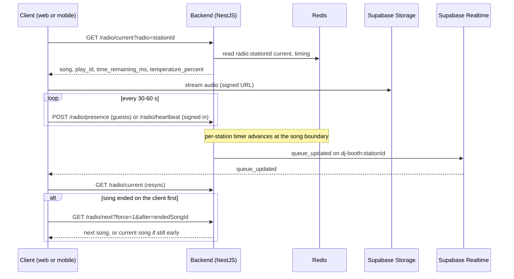
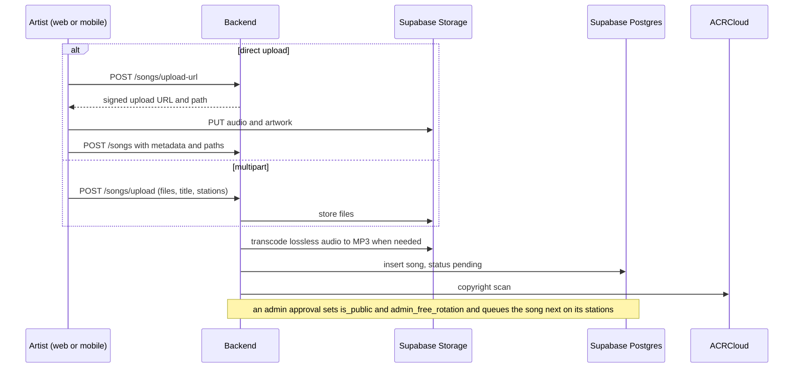
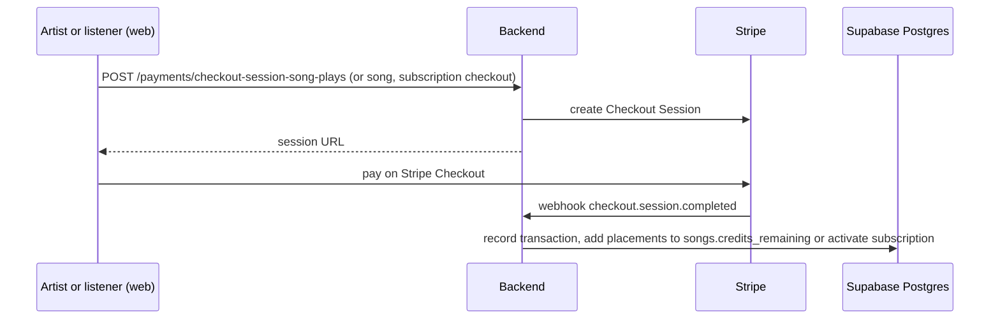
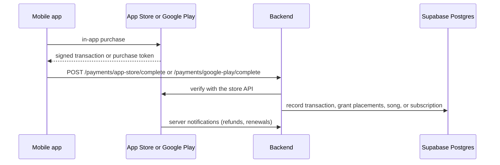
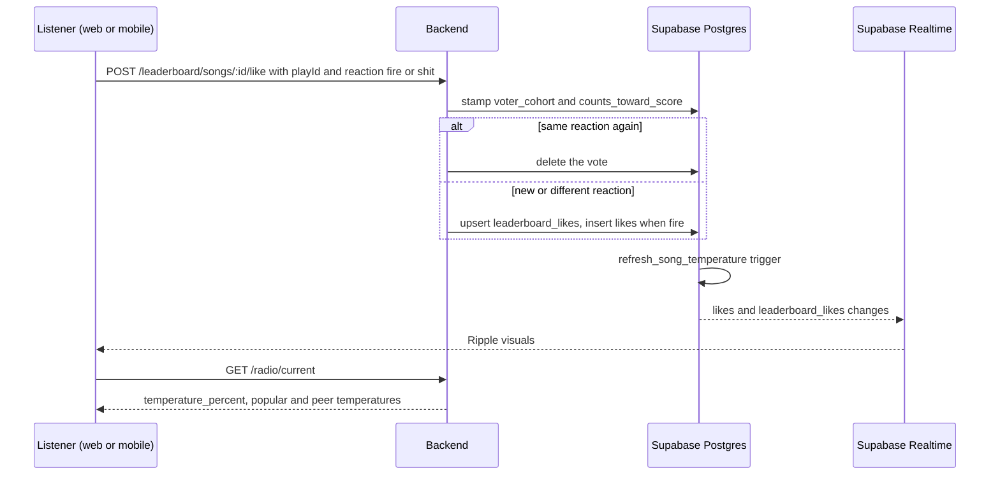
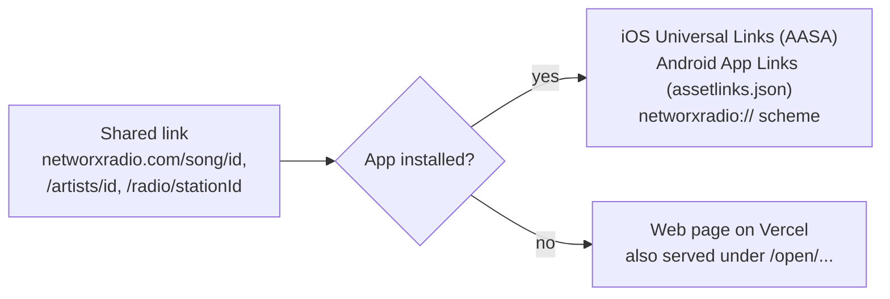

# NETWORX System Architecture Diagram

**Product:** NETWORX Radio: The Butterfly Effect, plus **Pro-Networx** (the network for Catalysts, the industry service providers)  
**Tagline:** By artists, for artists.

---

## High-Level Architecture

```mermaid
flowchart TB
  subgraph Clients
    WEB["Web app (Next.js on Vercel)<br/>www.networxradio.com<br/>www.pro-networx.com"]
    MOB["Mobile app (Flutter)<br/>iOS and Android"]
    ADM["Admin app (Next.js, admin/)<br/>plus /admin pages in web"]
  end

  subgraph Vercel
    MW["middleware.ts<br/>host-aware Pro-Networx routing"]
    RW["/api/* rewrite to backend<br/>local routes: auth login, logout,<br/>cross-domain-exchange"]
    WK[".well-known<br/>apple-app-site-association<br/>assetlinks.json"]
  end

  subgraph Railway
    API["NestJS 11 API (Docker, Node 22)<br/>global prefix /api"]
    RD[("Redis<br/>radio state, locks,<br/>caches, BullMQ")]
  end

  subgraph Supabase
    PG[("PostgreSQL<br/>public + pro_networx schemas")]
    ST["Storage<br/>audio, artwork, feed media"]
    RT["Realtime<br/>dj-booth and radio-chat channels,<br/>station_events, likes"]
  end

  subgraph External["Third-party services"]
    FB["Firebase<br/>Auth and FCM push"]
    STRIPE["Stripe<br/>Checkout, Connect, webhooks"]
    STORES["App Store and Google Play<br/>in-app purchases, server notifications"]
    CFS["Cloudflare Stream<br/>WHIP ingest, WHEP playback"]
    R2["Cloudflare R2<br/>optional media mirror"]
    TW["Twilio<br/>sign-in codes by SMS"]
    MAIL["Email<br/>SendGrid or Resend"]
    ACR["ACRCloud<br/>copyright scans"]
    EL["ElevenLabs<br/>lyrics transcription and timing"]
    GV["Google Vision<br/>image moderation"]
    SEN["Sentry<br/>backend and mobile errors"]
  end

  WEB --> MW --> RW --> API
  WEB --> WK
  ADM --> API
  MOB -->|"direct to Railway first"| API
  WEB -.->|"realtime subscribe"| RT
  MOB -.->|"realtime subscribe"| RT
  WEB -->|"sign in"| FB
  MOB -->|"sign in, push tokens"| FB
  WEB -->|"Checkout redirect"| STRIPE
  MOB -->|"purchases"| STORES

  API --> RD
  API --> PG
  API --> ST
  API --> RT
  API --> FB
  API --> STRIPE
  API --> STORES
  API --> CFS
  API --> R2
  API --> TW
  API --> MAIL
  API --> ACR
  API --> EL
  API --> GV
  API --> SEN
  MOB --> SEN
```



**Backend modules** (`backend/src/`): radio (rotation, presence, prospector), songs, albums, playlists, song-stories, lyrics, uploads, copyright, leaderboard, competition, spotlight, chat, discovery, browse, feed, suggestions, analytics, credits, payments, creator-network, pro-network-subscription, pro-radio-subscription, pro-bundle-subscription, refinery, yield, artist-live, live-services, dj-booth, streaming, pro-networx, service-providers, studios, job-board, service-messages, notifications, push-notifications, growth, fans, moderation, venue-ads, flags, app-version, email, users, auth, admin, tasks. Route details are in [api-spec.md](api-spec.md).

**Access:** every request passes Firebase token verification, role checks, and the phone sign-in code check unless the route is marked public or exempt (see api-spec.md).

`*` **Quick-add minutes:** `POST /payments/quick-add-minutes` (artist/admin) remains in the API. It is **not** exposed on the main **Engine / Stage** listen experience (web + mobile).

---

## Feature Matrix: Web vs Mobile

```
┌────────────────────────────────────┬─────────┬─────────┐
│            FEATURE                 │   WEB   │ MOBILE  │
├────────────────────────────────────┼─────────┼─────────┤
│ LIVE RADIO & PLAYBACK              │         │         │
├────────────────────────────────────┼─────────┼─────────┤
│ Synchronized radio (30 stations)   │    ✅   │    ✅   │
│ Continuous playback                │    ✅   │    ✅   │
│ Radio controls (play/pause/volume) │    ✅   │    ✅   │
│ Background playback                │    ✅   │    ✅   │
│ Presence + heartbeat (listening)   │    ✅   │    ✅   │
│ Play reporting                     │    ✅   │    ✅   │
│ Lock screen / Dynamic Island votes │    —    │    ✅   │
│ Android Auto station list          │    —    │    ✅   │
├────────────────────────────────────┼─────────┼─────────┤
│ ARTIST CONTENT                     │         │         │
├────────────────────────────────────┼─────────┼─────────┤
│ Song upload                        │    ✅   │    ✅   │
│ Moderation workflow                │    ✅   │    —    │
│ Discovery placements (per song)    │    ✅   │    ✅   │
│ Artist discography + albums        │    ✅   │    ✅   │
│ Live services (promote + support)  │    ✅   │    ✅   │
│ Profile listens                    │    ✅   │    —    │
├────────────────────────────────────┼─────────┼─────────┤
│ ENGAGEMENT & RIPPLES               │         │         │
├────────────────────────────────────┼─────────┼─────────┤
│ Ripples (persistent likes)         │    ✅   │    ✅   │
│ Radio votes fire/poop (per play)   │    ✅   │    ✅   │
│ Song temperature on now-playing    │    ✅   │    ✅   │
│ Vote once per play (tap to undo)   │    ✅   │    ✅   │
│ Song rating (1–10)                 │    ✅   │    ✅   │
│ Song Comments thread               │    ✅   │    ✅   │
│ Song stories (24 h)                │    ✅   │    ✅   │
│ Realtime Ripple visuals            │    ✅   │    —    │
│ Rising Star / Butterfly Ripple     │    ✅   │    ✅   │
├────────────────────────────────────┼─────────┼─────────┤
│ COMPETITION & LEADERBOARDS         │         │         │
├────────────────────────────────────┼─────────┼─────────┤
│ By Ripples                         │    ✅   │    ✅   │
│ By discoveries (listens)           │    ✅   │    ✅   │
│ By positive votes / ratio / saves  │    ✅   │    ✅   │
│ Trial by Fire                      │    ✅   │    ✅   │
│ Spotlight / Top 7                  │    ✅   │    ✅   │
├────────────────────────────────────┼─────────┼─────────┤
│ LIVE CHAT & SOCIAL                 │         │         │
├────────────────────────────────────┼─────────┼─────────┤
│ Live radio chat                    │    ✅   │    ✅   │
│ Emoji reactions                    │    ✅   │    ✅   │
├────────────────────────────────────┼─────────┼─────────┤
│ ARTIST LIVESTREAM                  │         │         │
├────────────────────────────────────┼─────────┼─────────┤
│ Go live / Stop live                │    ✅   │    ✅   │
│ Watch live                         │    ✅   │    ✅   │
│ Stream donations                   │    ✅   │    ✅   │
│ Stream moderation                  │    ✅   │    —    │
│ Radio player live link             │    ✅   │    —    │
├────────────────────────────────────┼─────────┼─────────┤
│ PRO-RADIO                          │         │         │
├────────────────────────────────────┼─────────┼─────────┤
│ On-demand opted-in songs           │    ✅   │    ✅   │
│ Playlists                          │    ✅   │    ✅   │
├────────────────────────────────────┼─────────┼─────────┤
│ NOTIFICATIONS                      │         │         │
├────────────────────────────────────┼─────────┼─────────┤
│ Up Next / Live Now (push)          │    —    │    ✅   │
│ In-app notifications               │    ✅   │    ✅   │
│ Creator Network events             │    ✅   │    ✅   │
├────────────────────────────────────┼─────────┼─────────┤
│ THE YIELD (PROSPECTOR REWARDS)     │         │         │
├────────────────────────────────────┼─────────┼─────────┤
│ Yield balance                      │    ✅   │    ✅   │
│ Check-in                           │    ✅   │    ✅   │
│ Refinement                         │    ✅   │    ✅   │
│ Survey                             │    ✅   │    ✅   │
│ Redemption ($5/$10/$25 Visa)       │    ✅   │    ✅   │
│ Rewards Command Center             │    ✅   │    ✅   │
├────────────────────────────────────┼─────────┼─────────┤
│ THE REFINERY                       │         │         │
├────────────────────────────────────┼─────────┼─────────┤
│ List Refinery songs                │    ✅   │    ✅   │
│ Add/remove from Refinery           │    ✅   │    ✅   │
│ Rank (1–10)                        │    ✅   │    ✅   │
│ Comments                           │    ✅   │    ✅   │
├────────────────────────────────────┼─────────┼─────────┤
│ PLACEMENTS & PAYMENTS              │         │         │
├────────────────────────────────────┼─────────┼─────────┤
│ Placement balance (welcome)        │    ✅   │    ✅   │
│ Buy song placements                │ Stripe  │ App St. │
│                                    │         │ / Play  │
│ Buy songs and beats                │ Stripe  │ App St. │
│                                    │         │ / Play  │
│ Subscriptions (Creator Network,    │ Stripe  │ App St. │
│   Pro-Networx, Pro-Radio)          │         │ / Play  │
│ Quick Add minutes (API; not Engine)│    —    │    —    │
│ Transactions                       │    ✅   │    ✅   │
│ Artist payouts (Stripe Connect)    │    ✅   │    —    │
├────────────────────────────────────┼─────────┼─────────┤
│ THE WAKE (ANALYTICS)               │         │         │
├────────────────────────────────────┼─────────┼─────────┤
│ Artist analytics summary           │    ✅   │    ✅   │
│ ROI                                │    ✅   │    ✅   │
│ Listener heatmap (by region)       │    ✅   │    ✅   │
│ Discoverable toggle                │    ✅   │    ✅   │
├────────────────────────────────────┼─────────┼─────────┤
│ DISCOVERY & PRO-NETWORX            │         │         │
├────────────────────────────────────┼─────────┼─────────┤
│ Discover people                    │    ✅   │    ✅   │
│ Nearby (location)                  │    —    │    ✅   │
│ Provider profile                   │    ✅   │    ✅   │
│ Pro-NETWORX directory              │    ✅   │    ✅   │
│ Pro-NETWORX profile                │    ✅   │    ✅   │
│ Pro-NETWORX onboarding             │    ✅   │    —    │
│ Studios                            │    ✅   │    ✅   │
├────────────────────────────────────┼─────────┼─────────┤
│ MESSAGING & CREATOR NETWORK        │         │         │
├────────────────────────────────────┼─────────┼─────────┤
│ DMs (conversations)                │    ✅   │    ✅   │
│ Message requests (accept)          │    ✅   │    ✅   │
│ Creator Network paywall            │    ✅   │    ✅   │
│ Job board                          │    ✅   │    ✅   │
├────────────────────────────────────┼─────────┼─────────┤
│ VENUE & SPONSORSHIP                │         │         │
├────────────────────────────────────┼─────────┼─────────┤
│ Venue Partner slot                 │    ✅   │    ✅   │
├────────────────────────────────────┼─────────┼─────────┤
│ ADMIN (web only)                   │         │         │
├────────────────────────────────────┼─────────┼─────────┤
│ Song moderation + copyright        │    ✅   │    —    │
│ User management                    │    ✅   │    —    │
│ Free rotation                      │    ✅   │    —    │
│ Radio queue / override             │    ✅   │    —    │
│ DJ Booth                           │    ✅   │    ✅   │
│ Activity flags (vote integrity)    │    ✅   │    —    │
│ Analytics (platform-wide)          │    ✅   │    —    │
│ Artist live moderation             │    ✅   │    —    │
├────────────────────────────────────┼─────────┼─────────┤
│ AUTH & SECURITY                    │         │         │
├────────────────────────────────────┼─────────┼─────────┤
│ Firebase Auth (Email/Google/Apple) │    ✅   │    ✅   │
│ Phone sign-in code (SMS)           │    ✅   │    ✅   │
│ Cross-domain sign-in handoff       │    ✅   │    —    │
│ Session cookies (SSR)              │    ✅   │    —    │
│ Bearer token (API)                 │    ✅   │    ✅   │
│ Role-based access                  │    ✅   │    ✅   │
│ Account deletion (48 h grace)      │    ✅   │    ✅   │
└────────────────────────────────────┴─────────┴─────────┘
```

---

## Data Flow Diagrams

### 1. Live Radio Playback Flow



### 2. Artist Upload Flow



### 3. Payment Flows

**Web (Stripe):**



**Mobile (App Store / Google Play):**



Stripe is web-only for digital goods; the backend rejects Stripe checkout for these products from iOS and Android. The mobile app still uses the Stripe Payment Sheet for livestream donations.

### 4. Ripple / radio vote flow



### 5. Deep links



AASA app id: `8QZ4S3G53V.com.tmaktechnologies.networxradio`. Linked paths: `/artists/*`, `/artist/*`, `/song/*`, `/songs/*`, `/radio/*`, and the same under `/open/`.

---

## Technology Stack Summary

```
┌─────────────────────────────────────────────────────────────────┐
│                        FRONTEND                                 │
├─────────────────────────────┬───────────────────────────────────┤
│          WEB                │            MOBILE                 │
├─────────────────────────────┼───────────────────────────────────┤
│ Next.js 16 (App Router)     │ Flutter (Dart SDK ^3.10)          │
│ React 19                    │ Provider (state)                  │
│ TypeScript                  │ just_audio + audio_service        │
│ Radix UI + Tailwind CSS 4   │ firebase_auth + firebase_messaging│
│ Hls.js (audio)              │ in_app_purchase (App Store/Play)  │
│ Supabase Realtime           │ flutter_stripe (donations)        │
│ Firebase Web SDK            │ supabase_flutter                  │
│ PWA (next-pwa)              │ app_links, home_widget            │
│ Vercel Speed Insights       │ flutter_webrtc, sentry_flutter    │
└─────────────────────────────┴───────────────────────────────────┘

┌─────────────────────────────────────────────────────────────────┐
│                        BACKEND                                  │
├─────────────────────────────────────────────────────────────────┤
│ NestJS 11 (Node.js 22, Docker on Railway)                       │
│ TypeScript, REST API (/api/*)                                   │
│ Firebase Admin SDK                                              │
│ Supabase JS client + pg (direct pool)                           │
│ ioredis + BullMQ (scheduled pushes)                             │
│ Stripe SDK, App Store Server Library, googleapis (Play)         │
│ ffmpeg (audio transcode)                                        │
│ Winston (logging), Sentry (errors)                              │
└─────────────────────────────────────────────────────────────────┘

┌─────────────────────────────────────────────────────────────────┐
│                      INFRASTRUCTURE                             │
├─────────────────────────────────────────────────────────────────┤
│ Vercel         │ Web app for both domains, /api rewrite        │
│ Railway        │ NestJS backend, Redis                         │
│ Supabase       │ PostgreSQL, Realtime, Storage                 │
│ Firebase       │ Auth, FCM push notifications                  │
│ Stripe         │ Web payments, subscriptions, Connect payouts  │
│ App Store/Play │ Mobile in-app purchases                       │
│ Cloudflare     │ Stream (livestream, DJ Booth), R2 (optional)  │
│ Twilio         │ SMS sign-in codes                             │
│ Sentry         │ Backend and mobile error tracking             │
│ Docker         │ Local dev (docker-compose: redis, backend)    │
└─────────────────────────────────────────────────────────────────┘
```

---

## User Roles & Access

```
┌─────────────────────────────────────────────────────────────────┐
│                         ROLES                                   │
├──────────────┬──────────────────────────────────────────────────┤
│   LISTENER   │ • Listen to radio (guests can listen too)       │
│ (Prospector) │ • Vote/Ripple and rate tracks                   │
│              │ • Live chat and song Comments                   │
│              │ • Yield rewards (check-in, refinement, redeem)  │
│              │ • Refinery (rank, comment)                      │
│              │ • Discovery / Pro-Networx (browse), job board   │
├──────────────┼──────────────────────────────────────────────────┤
│    ARTIST    │ • All listener features                         │
│              │ • Upload songs, beats, albums                   │
│              │ • Buy placements, apply welcome placements      │
│              │ • Analytics (The Wake)                          │
│              │ • Go live (artist livestream)                   │
│              │ • Receive donations, sell songs, payouts        │
│              │ • Add songs to Refinery                         │
├──────────────┼──────────────────────────────────────────────────┤
│   CATALYST   │ • All artist-level features                     │
│  (service_   │ • Pro-NETWORX profile, services, studios        │
│   provider)  │ • Listed in Pro-Directory                       │
│              │ • Receive messages (Creator Network)            │
├──────────────┼──────────────────────────────────────────────────┤
│ DJ/MUSICIAN  │ • Artist-level access                           │
├──────────────┼──────────────────────────────────────────────────┤
│    ADMIN     │ • All features                                  │
│              │ • Song moderation (approve/reject, copyright)   │
│              │ • User management (ban, roles)                  │
│              │ • Radio queue and free rotation control         │
│              │ • DJ Booth                                      │
│              │ • Artist live moderation                        │
│              │ • Platform analytics, activity flags            │
└──────────────┴──────────────────────────────────────────────────┘
```

Members can hold extra maker roles (`users.user_roles`: artist, service_provider, musician, dj) in addition to their primary role. Votes from members with a maker role count as **peer** votes; everyone else's count as **popular** votes.

---

## Folder Structure

```
RadioApp/
├── backend/                 # NestJS API server (Railway)
│   ├── src/
│   │   ├── admin/           # Admin endpoints
│   │   ├── analytics/       # The Wake analytics
│   │   ├── artist-live/     # Livestream module
│   │   ├── auth/            # Firebase, roles, phone-code guards
│   │   ├── chat/            # Live chat and song Comments
│   │   ├── credits/         # Placement balance
│   │   ├── discovery/       # People, feed, map
│   │   ├── dj-booth/        # DJ Booth controls
│   │   ├── leaderboard/     # Votes and competition
│   │   ├── payments/        # Stripe, App Store, Google Play
│   │   ├── pro-networx/     # Pro-Networx profiles and services
│   │   ├── push-notifications/
│   │   ├── radio/           # Rotation, presence, Prospector
│   │   ├── songs/           # Song management
│   │   ├── studios/         # Studio listings
│   │   ├── uploads/         # Signed URLs, audio transcode
│   │   ├── users/           # User profiles
│   │   └── …                # see "Backend modules" above
│   └── supabase/migrations/ # SQL migrations
│
├── web/                     # Next.js web app (Vercel, both domains)
│   └── src/
│       ├── app/             # App Router pages (radio, dashboard, pro-networx)
│       ├── components/      # UI components
│       ├── lib/             # Utilities (api, radio-sync)
│       └── middleware.ts    # Host-aware routing
│
├── mobile/                  # Flutter mobile app
│   └── lib/
│       ├── core/            # Auth, services, navigation
│       ├── features/        # Feature screens
│       └── widgets/         # Shared widgets
│
├── admin/                   # Admin dashboard (Next.js)
├── docs/                    # Documentation
├── scripts/                 # Tooling
├── store-assets/            # App store listing assets
├── presentation/            # Pitch materials
└── archive/                 # Retired code
```
